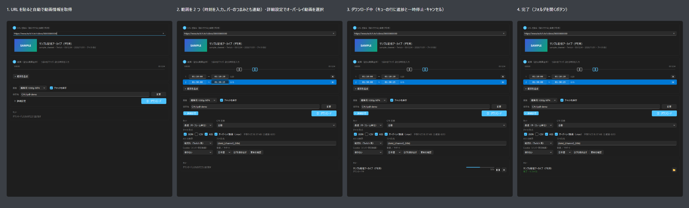

# clipdl（ベータ版）

> **これはベータ版（0.1.0b3）です。** 少人数の方にお試しいただくための版で、正式版の前に動作や仕様が
> 変わることがあります。不具合を見つけたら、下の「[困ったとき](#困ったとき)」の手順でご報告ください。

YouTube / Twitch の動画（VOD・アーカイブ）を、**範囲指定**と**チャットの同時取得**つきでダウンロードする
Windows 用のアプリです。配信の切り抜き編集をする人向けに作っています。

**権利者の許諾がある、または自分が権利を持つコンテンツにのみ使用してください。**
DRM で保護されたコンテンツには対応していません。詳しくは [TERMS.md](TERMS.md)（利用規約）を参照してください。



## できること

- URL を貼るだけで動画情報（タイトル・長さ・サムネイル・チャンネル名）を取得
- 範囲を複数指定して、必要な部分だけをダウンロード（全体をダウンロードしてから切ることはしません）
  - 高速: キーフレーム単位でカット（再エンコードなし）
  - 正確: 再エンコードしてフレーム単位でカット（GPU のエンコーダを自動で選択）
- 編集ソフトで扱いやすい形に整える: 編集用 1080p MP4、VFR（可変フレームレート）の自動 CFR 化
- チャットの保存: YouTube のライブチャット / Twitch の VOD チャット
  - 範囲に合わせて切り出し、クリップの先頭を 0 秒にした時刻で出力
  - 形式: JSON（元データつき）/ CSV / ASS（縦流れ・横流れ）/ **オーバーレイ動画（背景が透明な .mov）**
- 複数 URL のキュー、一時停止・再開・キャンセル
- メンバー限定動画のためのブラウザ Cookie 読み込み
- yt-dlp の更新（署名を検証してから差し替え）

## 動作環境

- Windows 10 / 11（64bit）
- 空き容量: アプリ本体で約 450 MB ＋ ダウンロードする動画の分
- インターネット接続
- Python などを別に入れる必要はありません（ffmpeg・Deno なども同梱しています）

## インストール

1. 配布ページから `clipdl-<版>-win64.zip` と `clipdl-<版>-win64.zip.sha256` をダウンロードします。
2. （おすすめ）zip が壊れたり差し替えられたりしていないか、SHA-256 を確かめます。
   PowerShell で次を実行し、表示された値が `.sha256` ファイルの値と同じなら問題ありません。
   ```powershell
   Get-FileHash .\clipdl-0.1.0b3-win64.zip -Algorithm SHA256
   ```
3. zip を右クリック →「プロパティ」→ 下の方の「許可する」にチェック →「OK」。
   （先にこれをしておくと、展開したファイルごとに警告が出るのを防げます）
4. zip を好きな場所に展開します（例: `C:\Tools\clipdl`）。`Program Files` は避けてください（書き込みの権限のため）。
5. `clipdl.exe` をダブルクリックして起動します。初回は利用規約が表示されます。

### 「Windows によって PC が保護されました」と表示されたとき（SmartScreen）

clipdl はコード署名をしていないため、初回の起動時に Microsoft Defender SmartScreen の警告が出ることがあります。

1. 青い画面の「**詳細情報**」をクリックします。
2. 「アプリ: clipdl.exe」「発行元: 不明な発行元」と表示されるので、「**実行**」をクリックします。

- 配布ページの SHA-256 と一致することを確かめてから実行してください（インストールの手順 2）。
- 一致しない場合や、配布ページ以外から入手した場合は実行しないでください。
- 会社の PC などで「実行」が表示されない場合は、管理者に相談してください。

### アンインストール

展開したフォルダを削除します。設定・ログ・キャッシュは次の場所にあります（不要なら削除してください）。

- 設定: `%LOCALAPPDATA%\clipdl`
- ログ: `%LOCALAPPDATA%\clipdl\Logs`
- キャッシュ（チャット）: `%LOCALAPPDATA%\clipdl\Cache`
- 更新した yt-dlp: `%LOCALAPPDATA%\clipdl\updates`

## 使い方（GUI）

1. **URL を貼る** … 自動で動画情報を取得します。複数の URL を貼ると「N 件をキューに追加
   （動画全体・現在の設定）」と確認が出ます。
2. **範囲** … 「＋ 範囲を追加」で増やし、時刻を入力するか、バーのつまみをドラッグします。
   つまみを選んで ← → で 1 秒、Shift＋← → で 10 秒動かせます。範囲が空なら動画全体です。
3. **ダウンロード** … キューに追加されます。各行のボタンで一時停止・再開・キャンセル・フォルダを開く。

「詳細設定」で、カット（高速 / 正確）、CFR 変換、チャットの形式、ASS の表示、ファイル名、Cookie、言語を
変えられます。エラーは画面の下に 1 行で表示され、「詳しく」で原文を確認できます。

### 出力されるファイル

| ファイル | 内容 |
|---|---|
| `<名前>_c01_010000-010230.mp4` | 範囲 1 の動画（範囲ごとに 1 本） |
| `….chat.json` | チャット（元データつき。`time` はクリップ先頭からの秒、`time_in_video` は動画内の秒） |
| `….chat.csv` | チャット（時刻・ユーザー名・本文。Excel で開ける UTF-8） |
| `….chat.ass` | チャットの字幕（縦流れ・Twitch 風 / 横流れ・ニコニコ風） |
| `….chat_overlay.mov` | チャットのオーバーレイ動画（背景が透明。初期値は OFF） |

## オーバーレイ動画

ASS は Premiere / DaVinci Resolve で読み込めないため、チャットを背景が透明な動画にして書き出します。
初期値は **QuickTime Animation（qtrle・差分方式）／チャット欄の幅だけ切り出し／30fps** です
（実測で 1 分あたり約 64 MB。チャットのチェックの横に予想サイズを表示します）。

### Premiere での置き方

1. クリップ本体でシーケンスを作る（例: 1920x1080）
2. `*.chat_overlay.mov` を本体の上のトラックに、先頭をそろえて置く
3. エフェクトコントロールの「モーション → 位置」を、ログ（とコマンドライン版の出力）に出る値にする
   - 1920x1080 の場合: **X = 1635、Y = 540**（切り出し範囲 x=1350〜1920、幅 570）
   - 一般には X = 切り出しの左端 + 幅 / 2、Y = 高さ / 2
   - この X/Y は、クリップ本体と同じ 1920x1080 のシーケンスに置く場合の値です。縦型（1080x1920）など
     ほかのサイズのシーケンスでは、自分で配置してください

切り出しをしない（全画面）設定、または横流れ（ニコニコ風）なら、位置は初期値（画面中央）のままで重なります。

### 形式の比較（Twitch・チャット多め・20 秒・1080p で実測）

| 形式 | 切り出し | fps | サイズ | 1 分あたり | Premiere 2026 |
|---|---|---|---|---|---|
| **QuickTime Animation（初期値）** | あり（570x1080） | 30 | **21 MB** | **約 64 MB** | アルファ付きで表示・途中シークも正常 |
| QuickTime Animation | なし | 30 | 24 MB | 約 72 MB | 同上 |
| QuickTime Animation | あり | 60 | 33 MB | 約 98 MB | 同上 |
| QuickTime Animation（全フレーム キーフレーム） | あり | 30 | 181 MB | 約 543 MB | 表示できる（容量が大きいので不採用） |
| PNG in MOV | あり | 30 | 90 MB | 約 269 MB | アルファ付きで表示 |
| ProRes 4444（qscale 8） | あり | 30 | 108 MB | 約 325 MB | アルファ付きで表示 |
| ProRes 4444（qscale 8） | なし | 60 | 243 MB | 約 729 MB | — |

形式・切り出し・fps は、いまは設定ファイル（`%LOCALAPPDATA%\clipdl\settings.json` の `overlay_codec` /
`overlay_crop` / `overlay_fps`）で変えられます（画面の詳細設定には未掲載）。

## エンコーダ

正確モードと CFR 変換では、次の順に使えるものを自動で選びます。エンコード中に失敗した場合は、
次のエンコーダで自動的にやり直します（理由はログに残ります）。

1. h264_nvenc（NVIDIA） 2. h264_qsv（Intel） 3. h264_amf（AMD） 4. h264_mf（Windows Media Foundation）
5. libopenh264 6. libx264（GPL 版 ffmpeg を自分で用意した場合のみ）

## clipdl の新しい版のお知らせ

起動時に、GitHub で clipdl の新しい版（ベータ版を含む）が公開されているかを確認します。
新しい版があれば、画面下部に「新しい版 vX.X.X があります」と［ダウンロードページを開く］ボタンが出ます。

- 確認は **1 日 1 回まで**です。通信に失敗したときは何も表示せず、そのまま使えます。
- 確認を止めたいときは、「詳細設定」の「新しい版を確認する」をオフにします。
- コマンドライン版では、`clipdl-cli.exe --check-update` の結果の先頭に表示されます（こちらはその場で確認します）。

### ワンクリック更新（0.1.0b3 から）

お知らせの［**更新する**］を押すと、次の順に進みます。勝手に再起動することはありません。

1. 新しい版の「更新情報」と署名を取得し、アプリに埋め込んだ鍵（Ed25519）で**署名を確かめます**
2. zip をダウンロードし、更新情報に書かれたサイズと SHA-256 と一致するかを確かめます
3. アプリのフォルダの隣（`clipdl.new`）に展開し、「再起動して更新しますか？」と確認します
   （［あとで］を選んだ場合は、次に起動したときに同じ確認を出します）
4. ［再起動して更新］を選ぶと clipdl が終了し、入れ替え用の小さなプログラム（`clipdl-updater.exe`）が
   フォルダを入れ替えて、新しい版を起動します

- 署名が無い・確かめられない・zip が一致しないなどの場合は**更新せず**、［ダウンロードページを開く］の案内に戻ります。
- 新しい版が正しく起動しなかった場合は、**自動で元の版に戻して**起動し、画面下部で理由をお知らせします。
- 1 つ前の版は `clipdl.old` として残します（次の更新のときに入れ替わります）。不要なら削除して構いません。
- 設定・ログ・キャッシュ・yt-dlp の更新版は `%LOCALAPPDATA%\clipdl` にあるので、そのまま引き継がれます。
- ダウンロード中のキューがあるときは、終わってから更新できます。
- アプリのフォルダの親フォルダに書き込めない場所（`Program Files` など）に置いている場合は使えません。
  その場合はダウンロードページから入手してください。
- コマンドライン版では `clipdl-cli.exe --self-update` で同じことができます（終わると GUI が起動します）。
- 0.1.0b2 以前にはこの機能がないため、0.1.0b3 へは一度だけ手動で入れ替えてください。

## yt-dlp の更新と署名検証

サイト側の仕様変更にすぐ追従できるよう、yt-dlp はアプリを更新しなくても新しい版に差し替えられます。
GUI は「詳細設定」→「更新を確認」→「更新する」。反映は次回の起動からです。

| 対象 | 確認方法 | 自動更新 |
|---|---|---|
| yt-dlp | 公式の `SHA2-256SUMS.sig`（GPG 署名）を、アプリに埋め込んだ yt-dlp の鍵で検証し、`SHA2-256SUMS` のハッシュと照合 | する |
| yt-dlp-ejs | その版の yt-dlp が指定する版を、PyPI が示す SHA-256 と照合（HTTPS） | する（yt-dlp と組で） |
| Deno | — | しない（アプリの新しい版を出すときに更新。「更新を確認」には版だけ表示） |

- 検証が通ったファイルだけを保存し、そのときの SHA-256 を記録します。**起動のたびに**ファイルを照合し、
  一致しなければ使わずに同梱版で動きます（画面下部とログに理由を表示）。
- 更新版を読み込めなかった場合（新しい版がアプリに無い部品を必要とするなど）も、同梱版に戻して起動します。
- 同梱版に戻したいときは、コマンドライン版で `clipdl-cli.exe --reset-updates` を実行します。
- 埋め込んでいる鍵: Simon Sawicki (yt-dlp signing key)、RSA 4096、
  指紋 `AC0C BBE6 848D 6A87 3464  AF4E 57CF 6593 3B5A 7581`
  （yt-dlp リポジトリの public.key と、keys.openpgp.org・keyserver.ubuntu.com の鍵で一致を確認済み）

### 鍵が変わったとき

- yt-dlp が署名の鍵を変えると、新しい版の署名は検証に通りません。その場合は **アプリを更新するまで
  同梱版（または前に検証済みの更新版）で動きます**。新しい鍵は、公式の発表と鍵サーバーで確かめてから
  アプリに埋め込み直します。
- 鍵の切り替え時期などに **署名が複数付いた場合も、検証は通らず同梱版で動きます**（「署名はちょうど 1 つ」
  のときだけ受け入れる設計のため。古い鍵の署名が含まれていても同じです）。
- 鍵の種類や署名の形式（例: Ed25519、v6 署名）が変わった場合も同様です。

## コマンドライン版

`clipdl-cli.exe` で、GUI と同じことができます。

```bat
clipdl-cli.exe --accept-terms --info "<URL>"
clipdl-cli.exe "<URL>" -r 00:01:00-00:02:00 -r 00:05:00-00:05:30 -m precise
clipdl-cli.exe "<URL>" --chat-only --chat-formats json,csv,ass,mov -r 00:30:00-00:31:00
clipdl-cli.exe --check-update
clipdl-cli.exe --update
clipdl-cli.exe --list-encoders
clipdl-cli.exe --export-logs %USERPROFILE%\Desktop
```

`clipdl-cli.exe --help` ですべてのオプションを表示します。

## 困ったとき

- エラーの内容は画面下の「詳しく」で確認できます（メンバー限定・地域制限・年齢制限などは日本語で表示）。
- YouTube で急に失敗するようになったら、まず「更新を確認」で yt-dlp を更新してください。
- ワンクリック更新のあとで clipdl が起動しなくなった場合: アプリを置いたフォルダの隣に `clipdl.old` があれば、
  それが元の版です。`clipdl` フォルダを別名にしてから、`clipdl.old` を `clipdl` に名前を変えると元の版を使えます。
  入れ替えの記録は `%LOCALAPPDATA%\clipdl\Logs\clipdl-updater.log` にあります（「ログを書き出す」にも含まれます）。

### 不具合を報告するとき

次の 1〜4 を送ってください。うまくいかなかった操作の直後にログを書き出すと、原因を調べやすくなります。

1. **ログ（zip ファイル）**
   - 「詳細設定」を開き、「言語 ／ サポート」の行にある「ログを書き出す」を押します。
   - 保存先のフォルダを選ぶと（初期値はデスクトップ）、`clipdl-logs-日付-時刻.zip` ができます。この zip を送ってください。
   - コマンドライン版の場合は `clipdl-cli.exe --export-logs %USERPROFILE%\Desktop` で同じ zip を作れます。
   - zip の中では、Windows のユーザー名と Cookie などの値を伏せ字にしています。気になる場合は、送る前に
     中身（テキストファイル）を開いて確認してください。
2. **Windows の版**
   - キーボードの `Windows` キー ＋ `R` を押し、`winver` と入力して Enter を押します。
   - 表示された画面の「バージョン 24H2（OS ビルド 26100.xxxx）」のような行を送ってください
     （「Windows 11 Home」などのエディションも分かれば一緒に）。
3. **URL の種類**（URL そのものは、差し支えなければで構いません）
   - YouTube：アーカイブ（ライブ配信の録画）／通常の動画／ショート／メンバー限定　のどれか
   - Twitch：過去の配信（`twitch.tv/videos/…`）／ハイライト／クリップ　のどれか
   - 範囲指定をしたか（した場合はおおよその開始・終了時刻）、チャットも保存したか
4. **起きたこと**：何をしたら、どうなったか（画面下のエラーの「詳しく」の内容、またはスクリーンショット）

clipdl の版は、ウィンドウのタイトル（例: `clipdl 0.1.0b3（ベータ版）`）とログの zip の中の `system.txt` に書いてあります。

## 既知の問題

- **QSV / AMF の画質設定は未検証です。** 開発環境は NVIDIA の GPU のみで、
  「使えないので飛ばす」動作しか確認できていません。失敗した場合は次のエンコーダへ自動で切り替わります。
- 高速モードはキーフレーム単位でカットするため、開始・終了が数秒ずれることがあります。チャットの時刻は指定した
  範囲を基準にするので、ずれた分だけ映像とずれます。正確に合わせたいときは正確モードを使ってください。
- Windows の Chrome / Edge は Cookie の暗号化方式の変更により、Cookie を読めないことがあります。Firefox か
  cookies.txt の指定をお試しください。
- YouTube のライブチャットは途中から取得できないため、範囲が一部でも配信全体のチャットを取得します
  （2 回目以降はキャッシュを使います。実測: 約 4 時間の配信で 13 秒・9.7 MB）。
- オーバーレイ動画は、編集ソフトに読み込めることを Premiere Pro 2026 でのみ確認しています。
  DaVinci Resolve では未確認です（QuickTime Animation を読めない場合は、ProRes 4444 に切り替えてください）。
- 日本語の長いコメントは、文字幅の見積もり（Yu Gothic UI で実測）で折り返します。別のフォントで表示される
  環境では、折り返し位置がずれることがあります。
- Twitch のチャット時刻は 1 秒単位です（Twitch 側の値が整数のため）。ASS とオーバーレイ動画では、同じ秒のコメントを
  その 1 秒の中で均等にずらして表示します（JSON / CSV は元の時刻のまま）。
- 一時停止は「中断して待機に戻す」方式です。範囲指定のダウンロードは再開時にその範囲をやり直します。
- yt-dlp のメタデータ埋め込み機能（mutagen を使うもの）は、mutagen が GPL のため同梱していません。
  clipdl の機能には影響しません。
- コード署名をしていないため、SmartScreen の警告が出ることがあります（上の「インストール」を参照）。

## ライセンス

- clipdl 本体は **MIT ライセンス**です（[LICENSE](LICENSE)）。MIT が適用されるのは clipdl 本体だけです。
- 同梱している第三者のソフトウェア（ffmpeg・yt-dlp・Deno・TwitchDownloaderCLI・Qt・Python など）のライセンスは
  [THIRD_PARTY_LICENSES.txt](THIRD_PARTY_LICENSES.txt) にまとめています。
- ffmpeg は LGPL v3 のビルドを DLL のまま同梱しています（`vendor\ffmpeg\bin` を差し替え可能）。
  ソースの入手先は `third_party\ffmpeg\BUILD_INFO.md` にあります。

---

## 開発者向け

```bash
cd clipdl
.venv\Scripts\python.exe -m clipdl.gui          # GUI
.venv\Scripts\python.exe -m clipdl --help       # CLI
.venv\Scripts\python.exe -m pytest -q           # テスト
```

- 依存: 配布物に入るものは `requirements.lock`、開発用を含むすべては `requirements-dev.lock`
- `vendor/` に ffmpeg（LGPL v3）・Deno・TwitchDownloaderCLI を置きます（git 管理外）。
  取得元とハッシュは [vendor/CHECKSUMS.txt](vendor/CHECKSUMS.txt)
- 配布物の作り方・SHA-256・VirusTotal での確認は [docs/RELEASE.md](docs/RELEASE.md)
- 計画と設計の経緯は [PLAN.md](PLAN.md)

テスト用の環境変数（値の前後の空白は無視します）:

| 環境変数 | 内容 |
|---|---|
| `CLIPDL_TEST_TREAT_BUNDLED_OLD=1` | 同梱版を古いものとみなし、最新版が同じでも更新の流れを試す |
| `CLIPDL_TEST_FAIL_ENCODERS=h264_nvenc` | 指定したエンコーダの本番エンコードだけをわざと失敗させる |
| `CLIPDL_DISABLE_ENCODERS` / `CLIPDL_ENCODER` | エンコーダを候補から外す / 指定したものだけ使う |
| `CLIPDL_YTDLP_VERBOSE=1` | yt-dlp の詳しいログをログファイルに出す |
| `CLIPDL_CONFIG_DIR` などの `CLIPDL_*_DIR` | 設定・ログ・キャッシュ・データの場所を変える |
| `CLIPDL_TEST_APP_VERSION=0.1.0` | 今の版をこの値とみなす（新しい版のお知らせとワンクリック更新を試す） |
| `CLIPDL_TEST_RELEASE_BASE=http://127.0.0.1:8000/` | ワンクリック更新のファイルを、GitHub ではなくローカルのサーバーから取得する |
| `CLIPDL_TEST_TRUST_KEY=<公開鍵 PEM のパス>` | 埋め込みの鍵に加えて、この公開鍵も信頼する（テスト用の鍵で署名したものを試す） |
